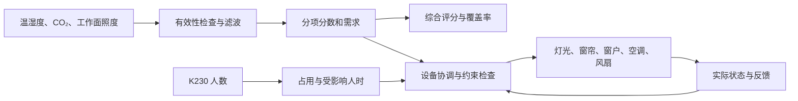

# EcoVision 综合舒适度与五类设备联动方案

2026-11-18 · 设计提案 v0.1 · 面向高校教室、自习室和桌面原型

[研究依据、适用范围与校准方案](COMFORT-EVIDENCE.md)

EcoVision 根据温度、湿度、通风和光照估计室内环境舒适度，根据视觉人数确定占用与受影响人时。总分用来展示和比较，分项需求决定动作，设备协调器负责处理冲突、人工接管和执行失败。现阶段的评分参数是可验证的工程初值，后续用现场数据和使用者反馈校准。

## 1. 输入和适用范围

| 输入 | 量纲和用途 | 原型证据与接入要求 |
|---|---|---|
| 人数 $N$ | 人，K230 给出计数、有效性与会话信息 | 复用当前 3 个有效正帧确认有人、连续有效零帧 30 秒确认无人。视觉失效标记 UNKNOWN。验收视场 0–5 人 |
| 气温 $T$、湿度 $H$ | ℃、%RH，AHT20。温度与湿度各自保存原始、滤波、时间与有效性 | 两项已有读取报告。独立采样和连续实采日志仍需确认 |
| 室内 $C$ | ppm，NDIR CO₂，作为通风分项 | 取得真实、完成暖机的 CO₂ 读数后启用。已有 MQ-135 原码只能单独观察或做相对变化实验 |
| 工作面照度 $E$ | lx，来自工作面照度计或经现场标定的读取值 | 当前 PC5 光敏是 ADC 原码。若仅完成相对等级标定，可以启用相对暗亮提示。完整照度分只有在 lx 映射通过独立参考测量后启用 |
| 室外条件和设备反馈 | 雨、风、室外空气质量、温度、限位、驱动状态、机型允许操作等 | 用于判断动作可否执行。缺失项按对应能力降级，窗和空调联动需要现场验证 |

每路携带采样时间、年龄、有效性、错误、来源与模拟标记。模拟的 CO₂ 或照度只在显式模拟配置中参与评分和模拟动作，实物控制要求相应信号为真实有效。空气分首版具体含义为**通风代理**。想覆盖颗粒物时，可在取得可靠 PM₂.₅ 测量后加入一个独立子项，空气分取两个子项的较低值，并记录评分配置版本。室内 CO₂ 本身受通风和占用等因素影响，全面空气质量还需要相应污染物测量。[ASHRAE 室内 CO₂ 立场文件](https://www.ashrae.org/File%20Library/About/Position%20Documents/PD_IndoorCarbonDioxide_2025.pdf)

该指数评价可测的室内环境条件。热感觉受辐射温度、空气流速、着衣量和活动水平等影响，取得这些输入与经过验证的模型后可替换热环境分项。照明合规还涉及均匀度、眩光、频闪等测项。单点 lx 用于工作面补光控制。[ASHRAE Standard 55](https://www.ashrae.org/technical-resources/bookstore/standard-55-thermal-environmental-conditions-for-human-occupancy) · [GB 7793-2025 及适用范围](https://www.ndcpa.gov.cn/jbkzzx/c100202/2019767782478352384/DfuK7Vv3.pdf)

## 2. 评分、人数和数据覆盖率

各分项取 0–100 分。对表中相邻点做线性插值，超过两端取端点分数。上下限和权重保存在场景配置中。下列参数对应首轮教室实验的假设，评分端点和控制触发阈值均属项目初值。

| 分项 | 各拐点与对应分数 | 权重 | 输出需求方向 |
|---|---|---:|---|
| 温度 $S_T$ | ≤17℃ 为 0，23–27℃ 为 100，≥33℃ 为 0 | 35% | 偏冷、适宜、偏热、未知 |
| 湿度 $S_H$ | ≤20%RH 为 0，40–60%RH 为 100，≥80%RH 为 0 | 15% | 偏干、适宜、偏湿、未知 |
| 通风 $S_C$ | ≤800 ppm 为 100，≥1500 ppm 为 0 | 30% | 正常、需通风、持续偏高、未知 |
| 光照 $S_E$ | ≤100 lx 为 0，300–500 lx 为 100，≥1000 lx 为 0 | 20% | 偏暗、适宜、照度高、未知 |

\[
S_{\text{avg}} = 0.35S_T+0.15S_H+0.30S_C+0.20S_E, \qquad
S = \min\bigl(S_{\text{avg}},\ \min(S_T,S_H,S_C,S_E)+20\bigr).
\]

四项有效时计算完整总分。最差分项加 20 分限制总分。原始加权结果和各分项可分别记录，以便复算。以 25℃、50%RH、1500 ppm、400 lx 为例，四项是 `100/100/0/100`，加权 70 分，最后 20 分，通风需求独立评估。

少一项时，完整总分输出 UNKNOWN。可单独显示「已测分项分」和覆盖率。已测分用有效项原权重重新归一化，并应用有效项最低分上限；覆盖率是有效权重之和。只有温湿度、且两项均为 100 分时，显示「温湿度 100，覆盖 50%，总分未知」。覆盖率表示测量范围。两个日期只在配置和有效项范围相同时比较已测分。

人数通过两条路径参与算法。

1. **占用门控。** 确认有人才启用人体需求驱动的照明和热调节。确认无人后进入设备节能状态，已测持续高 CO₂ 可继续触发通风评估。人数不明时保留已有保守状态，避免根据一次漏检关闭有人区域。
2. **受影响人时。** 对于每一类已有有效测量的需求，以 $N\,(100-S_i)/100$ 表示当前等效受影响人数，按有效时间积分得到等效人分钟。示例是 4 人在温度分 75 的环境中持续 10 分钟，温度分项累计 10 等效人分钟。可用于有多间教室时优先排查或做事件统计，不能覆盖设备联锁、通风需求或人工模式。人数未知的时段记录缺测。需要预测未来热负荷时，用已知房间体积、换气量及热工参数另建模型，并以真实日志验证。

## 3. 分项需求、执行器与反馈

分项需求按照测量方向触发。每个条件在样本有效、未过期时确认，越过进入和退出阈值之间保持状态。下表时长为候选值，现有桌面灯扇按 1.0.0 规则运行。空气分、照度分使用滤波窗口的结果，驱动错误、过期和异常事件在滤波前识别。新的采样失效打断对应确认。

| 执行器 | 动作建议 | 首轮确认与回退条件 |
|---|---|---|
| 灯光 | 有人且持续偏暗时补光。装有窗帘且适合采光时先尝试打开一档，待照度稳定后补光。照度高时优先降低当前人工光 | 示例 <280 lx 持续 10 秒增一档，>380 lx 持续 30 秒减一档。每次只动一个设备或一档，至少等 15 秒并收到新鲜读数再复评。各档和灯具能力现场确认 |
| 窗帘 | 缺光且无直射、遮阳冲突时打开一档。有日照导致的过亮或遮阳需求时合上一档，随后重新检查桌面照度 | 室内单点照度高只说明该点 lx 高，日照归因需室外/窗侧参考、人工标记或验证模型。限位、位置、机械防护和权限通过后启用。动作失败停止并提示检查 |
| 窗户 | 有持续通风需求且室外条件合适时建议开到已验证的通风位。无自动动作条件时提示人工处理 | 示例 CO₂ ≥1000 ppm 持续 120 秒进入、≤850 ppm 持续 180 秒退出、≥1500 ppm 持续 60 秒提示偏高。开窗要求当地许可、机械保护、无雨、风和室外空气处于允许范围。单个闭窗干簧管只确认关闭到位 |
| 空调 | 偏热时优先评估循环风扇和安全遮阳的条件，温度持续偏热仍超出目标时请求制冷。具备已验证供暖能力时，偏冷可提出供暖请求 | 制冷初值可试 ≥29℃ 持续 5 分钟进入，≤27℃ 持续 5 分钟解除请求。压缩机启停间隔、设定范围和模式切换服从机型要求。必须确认窗已关闭才发起普通制冷。仅用已经确认的绝对状态指令，发送成功和实际运行分别记录 |
| 风扇 | 有人且偏热时提供空气流动，优先使用已确认的开关能力 | 桌面版仍采用 ≥28℃持续 5 秒开、≤27℃持续 5 秒关。循环风扇作用于人体附近气流；CO₂ 通风需求由窗或其他换气设备处理 |

湿度的偏干、偏湿先提示并记录。若空调支持独立除湿，且现场确认不会导致过冷并能回读状态，可把除湿作为候选动作。只有室内外湿度信息与相应变化模型验证后才评估用开窗缓解湿度问题。上述阈值、回差、调档间隔均通过设备配置传入，评分公式无需跟随驱动型号修改。

## 4. 多设备协调与故障处理

每轮先读取当前模式和实际反馈，再更新分项需求。自动候选通过联锁、状态和能力检查后发出。对同一子系统的竞争动作按顺序处理，其他无冲突子系统可并行。优先顺序沿用现有硬件保护和手动控制契约，AUTO 内先处理可执行的通风需求，再满足温度和照明需求，最后减少设备使用。

灯光和窗帘共用一次光环境调整机会。若已知某个降档预计使照度低于补光阈值，则跳过该档。若只能试探，降档后测到照度不足就回到上一可用档，并记录这个档位在当前采光条件下不可用。等到采光或人员使用条件有实质变化再试。窗帘正在遮阳时锁住采光开帘请求，照度缺口由灯光填补。上述约束用于防止离散档位在阈值两侧反复切换。

| 同时需求 | 协调过程 |
|---|---|
| 高 CO₂、偏热且空调正在工作 | 先检查室外和开窗能力。允许窗式通风且现场配置支持协调时，向空调提出暂停请求并确认反馈，再开窗。得到通风恢复条件后请求关窗，确认关闭且满足空调最小间隔，再评估制冷。无法确认或室外条件不允许时，输出通风提醒并停止相应自动联动 |
| 偏热、日照强且桌面偏暗 | 已辨识的日照热负荷允许窗帘遮阳。遮阳稳定后按桌面真实照度补灯，供给不足就记录需求未满足 |
| 温度正常但 CO₂ 高 | 单独进入通风评估，即使光照或温度得分很高。缺可靠室外条件或反馈时提示人工通风评估 |
| 占用不明、数据掉线或网络中断 | 对应分项立即失去新动作依据。STM32 本地继续更新有效分项和控制权。桌面灯扇按现有失效保持及 60 秒关闭规则。窗帘、窗户、空调按各设备批准的故障状态处理 |
| 动作无反馈、未到位或收到人工接管 | 执行状态记为未知或超时，阻止依赖其到位的后续动作。机械装置停止，空调和窗的互锁继续有效。故障解除后重新确认，手动模式按原契约仲裁 |

各设备记录「建议、已发出、已确认、超时/拒绝」及原因。禁止把请求状态当反馈。重启后按每种设备的实际回读和复位策略重新建立状态。环境映射可用定点整数插值，规则用比较、计时和状态机，采样与联网分任务，便于在 STM32 上复用 `EvChannel` 和现有时效处理。设备状态和动作接口属于嵌入式集成，公共消息扩展由总控维护。

## 5. 验证与交付边界

| 层级 | 验证用例与记录 |
|---|---|
| 评分与缺失 | 跑拐点、线性区、一个严重分项、缺 CO₂／照度、混入模拟值。核对总分、分项、覆盖率、原因和受影响人时 |
| 联动回放 | 跑雨天高 CO₂、开窗时偏热、空调回读未知、窗帘遮阳后补灯、窗关闭未到位、人数短暂漏检和手动接管。检查不可执行动作次数、冲突命令、等待时间、动作次数与重复回放一致性 |
| 现场验证 | 在不同时间和座位记录有效温湿度、参考照度与 CO₂、真实人数和反馈。匿名采集热感觉、光环境评价与总体满意度。用一批课堂记录定参，按独立日期或课堂留出验证，分别报告分项越界时长、峰值、受影响人时、人工接管率和响应时延 |
| 对比结果 | 和现有占用控制及简单独立阈值控制比较。使用同一输入记录和初始状态。软件回放可评估命令时序与冲突，设备是否改善环境需实测。记录能耗时使用独立电表和可比工况 |

11 月 20 日的桌面闭环仍以已验证的灯扇能力、现有阈值和本地日志为关口。综合算法在缺少 CO₂、标定照度或执行器时可用合成场景验证接口和联动。实物五设备联动依赖新增测量、现场权限、驱动验证和总控安排。当前文件交付为算法设计提案，评分和五设备协调尚未集成进固件。
